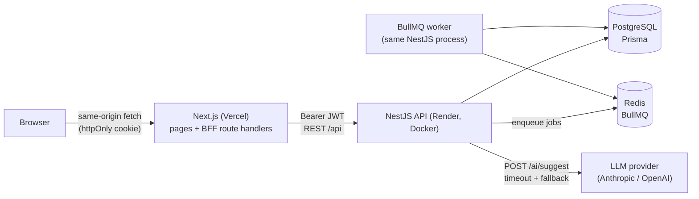
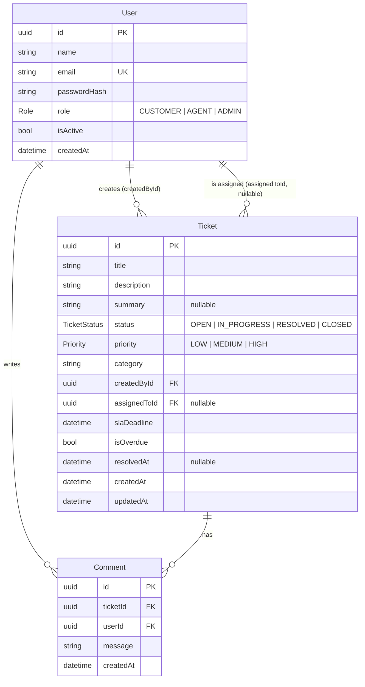

# Support Ticket System

Customers open support tickets, agents work on them, and admins manage everything.

- **Customers** create tickets (with optional AI help), see only their own tickets, and comment on them.
- **Agents** see the tickets assigned to them, move them through the status flow, and reply.
- **Admins** see every ticket, assign and reassign tickets, manage users, and view reports.

Two background jobs run on BullMQ: one auto-assigns new tickets to the least-busy agent, and one marks tickets overdue when they miss their SLA.

---

## Contents

1. [Architecture](#architecture)
2. [Tech stack](#tech-stack)
3. [Getting started](#getting-started)
4. [Environment variables](#environment-variables)
5. [Database schema](#database-schema)
6. [API summary](#api-summary)
7. [Business rules](#business-rules)
8. [Security](#security)
9. [AI feature and evaluation](#ai-feature-and-evaluation)
10. [Tests](#tests)
11. [Deployment](#deployment)
12. [Test credentials](#test-credentials)
13. [Assumptions and decisions](#assumptions-and-decisions)
14. [Future improvements](#future-improvements)

---

## Architecture



ASCII version:

```
 Browser ──(cookie)──▶ Next.js BFF ──(Bearer JWT)──▶ NestJS API ──▶ PostgreSQL
                       /api/auth/*                    │   ▲
                       /api/proxy/*                   ▼   │
                                                     Redis ◀── BullMQ worker
                                                      (auto-assign, SLA sweep)
                                       NestJS API ──▶ LLM (AI suggestions)
```

**Backend modules** (`backend/src`): `auth`, `users`, `tickets`, `comments`, `queue`, `ai`, `reports`, plus `health`, `prisma` and `common` (guards, decorators, the exception filter, DTO helpers).

**Frontend**: Next.js App Router pages under `frontend/src/app/{customer,agent,admin}`. The browser never calls the API directly. Instead:

- `/api/auth/login` and `/api/auth/register` call the API and store the JWT in an **httpOnly cookie**.
- `/api/proxy/[...path]` forwards every other request to the API and adds `Authorization: Bearer <token>` from that cookie.

Pages are protected twice:

1. `middleware.ts` redirects by role. It decodes the token but does not verify it, so it's only a UX guard.
2. Each role's `layout.tsx` checks the session on the server through `GET /auth/me`, which verifies the token.

The API checks permissions on every request either way.

## Tech stack

| Layer | Choice |
| --- | --- |
| Frontend | Next.js 15 (App Router), React 19, TypeScript, Tailwind CSS 4 |
| Backend | NestJS 11, TypeScript, Node.js 22 |
| Database | PostgreSQL 16 + Prisma 6 |
| Queue | BullMQ 5 + Redis 7 |
| Auth | JWT (passport-jwt), bcrypt (`bcryptjs`), role guard |
| Validation | class-validator + global `ValidationPipe`; zod for env and AI output |
| AI | Anthropic Messages API (structured output) or OpenAI (JSON schema), configurable |
| Tests | Jest + ts-jest |
| Containers | Docker (multi-stage) + docker-compose |
| Hosting | Vercel (frontend), Render (backend, Postgres, Key Value) |

## Getting started

### Prerequisites

| Tool | Version | Needed for |
| --- | --- | --- |
| Node.js | 20 or newer (22 recommended) | Local development |
| npm or pnpm | npm 10+ / pnpm 9+ | Installing packages (the repo ships `package-lock.json`, but pnpm works too) |
| Docker Desktop | Recent, with Compose v2 | Option A, or just Postgres + Redis for Option B |
| Git | Any | Cloning the repo |

```bash
git clone <repo-url> support-cus-ticket
cd support-cus-ticket
```

### Option A: Docker (everything in one command)

```bash
docker compose up --build
```

| Service | URL |
| --- | --- |
| Frontend | http://localhost:3000 |
| API | http://localhost:4000/api |
| Swagger docs | http://localhost:4000/api/docs |
| Health | http://localhost:4000/api/health |

When the backend container starts, it runs `prisma migrate deploy` and then the seed script. The seed is idempotent, and you can turn it off with `RUN_SEED=false`. Log in with one of the [test credentials](#test-credentials).

To turn on real AI suggestions, set `AI_API_KEY` (and optionally `AI_PROVIDER`/`AI_MODEL`) in your shell or in a root `.env` file before running compose.

If a host port is already taken (for example by a Postgres installed directly on Windows/macOS), override it. Compose also reads these from a root `.env` file:

```bash
POSTGRES_PORT=5435 REDIS_PORT=6380 BACKEND_PORT=4001 FRONTEND_PORT=3001 docker compose up --build
```

If you change `BACKEND_PORT` or `FRONTEND_PORT`, also update `FRONTEND_URL` (CORS) in `docker-compose.yml`.

Stop everything with `docker compose down` (add `-v` to also wipe the database volume).

### Option B: Local development (hot reload)

**1. Start Postgres and Redis.** The easiest way is Docker:

```bash
docker compose up -d postgres redis
```

If the full stack from Option A is running, stop its app containers first, otherwise ports 3000/4000 are taken: `docker compose stop backend frontend`.

**2. Backend** (first terminal):

```bash
cd backend
cp .env.example .env          # then check DATABASE_URL, REDIS_URL and JWT_SECRET
npm install                   # or: pnpm install
npx prisma migrate dev        # applies migrations and generates the Prisma client
npm run seed                  # demo users + tickets (safe to re-run)
npm run start:dev             # http://localhost:4000/api, Swagger at /api/docs
```

`DATABASE_URL` and `REDIS_URL` must use the host ports Postgres and Redis are published on. With the compose defaults that is `localhost:5432` and `localhost:6379`. If you set `POSTGRES_PORT=5435` / `REDIS_PORT=6380`, use those ports in `backend/.env` too.

**3. Frontend** (second terminal):

```bash
cd frontend
cp .env.example .env.local    # NEXT_PUBLIC_API_URL=http://localhost:4000/api
npm install                   # or: pnpm install
npm run dev                   # http://localhost:3000
```

Open http://localhost:3000 and log in with one of the [test credentials](#test-credentials).

With pnpm, every `npm run <script>` above is `pnpm <script>` (e.g. `pnpm start:dev`, `pnpm seed`), and `npx` is `pnpm exec`.

### Troubleshooting

| Symptom | Cause and fix |
| --- | --- |
| `start:dev` prints `Cannot find module '.../dist/main'` | A stale `tsconfig.build.tsbuildinfo` made the compiler skip output after `dist/` was deleted. The build info now lives inside `dist/`; if you still have an old `backend/tsconfig.build.tsbuildinfo`, delete it and rerun. |
| `Can't reach database server at localhost:XXXX` (P1001) | Postgres isn't running on the port in `DATABASE_URL`. Start it (`docker compose up -d postgres`) or fix the port. |
| `Authentication failed against database server` (P1000) | Something else (often a locally installed Postgres) answers on that port. Publish the compose Postgres on another port (`POSTGRES_PORT=5435`) and point `DATABASE_URL` at it. |
| `EADDRINUSE :::4000` / `:::3000` | The Docker `backend`/`frontend` containers already use the port. `docker compose stop backend frontend`, or run with `PORT=4100` and update the frontend's `NEXT_PUBLIC_API_URL`. |
| Login page says "The API is unreachable" | The frontend can't reach the API. Make sure the backend is running and `NEXT_PUBLIC_API_URL` (or `API_URL`) in `frontend/.env.local` points to it, including `/api`. |
| Login says "Invalid email or password" | The database hasn't been seeded, or the password is wrong. Run `npm run seed` in `backend/`. |
| Login succeeds but you're sent straight back to `/login` | In a production build (`npm start` / Docker) the session cookie is `Secure`. Browsers only accept that over HTTPS or on `http://localhost`; open the app at `http://localhost:3000`, not `127.0.0.1` or a LAN IP. |
| "Too many requests" on login | Login is rate-limited to 10 attempts per minute per IP. Wait a minute. |

### Useful commands

| Where | Command | What it does |
| --- | --- | --- |
| backend | `npm test` | Unit tests (no DB or Redis needed) |
| backend | `npx jest src/tickets/ticket-status.service.spec.ts` | Run a single test file |
| backend | `npx jest -t "skip"` | Run tests whose name matches a pattern |
| backend | `npm run lint` / `npm run typecheck` / `npm run format:check` | Static checks |
| backend | `npm run build` | Compile to `dist/` |
| backend | `npx prisma migrate dev --name <change>` | Create a new migration after editing `schema.prisma` |
| backend | `npx prisma studio` | Browse the database in a web UI |
| backend | `npm run eval` | AI classification accuracy report |
| frontend | `npm run lint` / `npm run typecheck` / `npm run build` | Static checks and production build |

## Environment variables

### Backend (`backend/.env.example`)

| Variable | Default | Purpose |
| --- | --- | --- |
| `DATABASE_URL` | none (required) | Postgres connection string |
| `REDIS_URL` | `redis://localhost:6379` | Redis for BullMQ (`rediss://` enables TLS) |
| `JWT_SECRET` | none (required, ≥16 chars) | HMAC secret for access tokens |
| `JWT_EXPIRES_IN` | `1d` | Token lifetime (`3600`, `12h`, `1d`, …) |
| `FRONTEND_URL` | `http://localhost:3000` | CORS allow-list (comma-separated) |
| `PORT` | `4000` | HTTP port |
| `TRUST_PROXY` | `1` | Number of proxy hops to trust for client IPs (rate limiting) |
| `SLA_CHECK_INTERVAL_MS` | `300000` | How often the SLA sweep runs |
| `AI_PROVIDER` | `none` | `anthropic`, `openai` or `none` |
| `AI_API_KEY` | empty | Provider API key. If empty, AI suggestions always use the fallback |
| `AI_MODEL` | `claude-opus-5-5` (anthropic), `gpt-4o-mini` (openai) | Model ID |
| `AI_TIMEOUT_MS` | `15000` | Hard timeout for the AI call |
| `RUN_SEED` | none | Docker only: `true` seeds on container start |

The environment is validated with zod at startup. A missing or invalid value stops the app with a clear message.

### Frontend (`frontend/.env.example`)

| Variable | Purpose |
| --- | --- |
| `NEXT_PUBLIC_API_URL` | API base URL including `/api`, e.g. `https://support-ticket-api.onrender.com/api`. Read on the **server** only, by the BFF. |
| `API_URL` | Optional runtime override with higher priority (docker-compose sets it to `http://backend:4000/api`). |

## Database schema



Indexes: `Ticket(status)`, `Ticket(assignedToId)`, `Ticket(createdById)`, `Ticket(slaDeadline)`, `Comment(ticketId, createdAt)` and `User(role)`.

The schema is in `backend/prisma/schema.prisma` and the migrations are in `backend/prisma/migrations`. Three fields go beyond the original spec; see [Assumptions](#assumptions-and-decisions) for why.

## API summary

All routes are under `/api`. Interactive docs are at **`/api/docs`** (Swagger, with Bearer auth). Errors always use this shape: `{ statusCode, error, message, path, timestamp }`.

| Method | Path | Roles | Notes |
| --- | --- | --- | --- |
| POST | `/auth/register` | public | Always creates a CUSTOMER. Rate limit: 10/min |
| POST | `/auth/login` | public | Returns `{ accessToken, user }`. Rate limit: 10/min |
| GET | `/auth/me` | any | Current user |
| POST | `/tickets` | CUSTOMER | Computes the SLA deadline and queues auto-assignment |
| GET | `/tickets` | any | Filtered by role. `?page&pageSize&status&priority&category` |
| GET | `/tickets/:id` | any | Returns 404 if the caller can't see the ticket |
| PATCH | `/tickets/:id/status` | AGENT (assigned), ADMIN | `{ status }`. Returns 400 for an invalid transition |
| PATCH | `/tickets/:id/assign` | ADMIN | `{ agentId }`. The target must be an active AGENT |
| GET | `/tickets/:id/comments` | any with access | Oldest first |
| POST | `/tickets/:id/comments` | any with access | `{ message }` |
| GET | `/users` | ADMIN | `?role&isActive&page&pageSize` |
| POST | `/users` | ADMIN | Create a user with any role |
| PATCH | `/users/:id` | ADMIN | `{ name?, role?, isActive? }`. Admins can't deactivate or demote themselves |
| GET | `/reports` | ADMIN | See below |
| POST | `/ai/suggest` | any | `{ title, description }` → `{ category, priority, summary, source }`. Rate limit: 10/min |
| GET | `/health` | public | Checks the database connection |

`GET /reports` returns:

- `totalTickets`
- `byStatus`, `byPriority`, `byCategory`
- `overdueCount` and `unassignedCount`
- `ticketsPerAgent` (active, resolved and total per agent)
- `averageResolutionHours`, the average time from created to RESOLVED

Every ticket response also includes `nextStatus`, the one status the ticket may move to next. The UI uses it so it only ever shows the valid action.

## Business rules

### Status flow

```
OPEN ──▶ IN_PROGRESS ──▶ RESOLVED ──▶ CLOSED
```

The logic lives in `backend/src/tickets/ticket-status.service.ts`, made of pure functions with no Nest or DB dependencies.

| Attempt | Result | Example message |
| --- | --- | --- |
| Next step | ✅ allowed | |
| Skipping a step | ❌ `SKIP` | `Cannot skip steps: OPEN can only move to IN_PROGRESS, not RESOLVED.` |
| Going backwards | ❌ `BACKWARD` | `Cannot move a ticket backwards from RESOLVED to OPEN.` |
| Same status | ❌ `SAME_STATUS` | `Ticket is already OPEN.` |
| Anything from CLOSED | ❌ `TERMINAL_STATUS` | `Ticket is CLOSED; a closed ticket cannot change status.` |

The API returns invalid transitions as **HTTP 400** with the message above. Status changes are conditional updates (`WHERE status = <current>`), so two concurrent changes can't both succeed; the second one gets a 409. Moving a ticket to RESOLVED sets `resolvedAt`.

### SLA

- The deadline is set when the ticket is created: **HIGH = 4h, MEDIUM = 24h, LOW = 48h** (`tickets/sla.ts`).
- A ticket is **overdue** if it is OPEN or IN_PROGRESS and `now > slaDeadline`.
- A **BullMQ repeatable job** (`sla-check`, registered with `upsertJobScheduler`, every `SLA_CHECK_INTERVAL_MS`) sets `isOverdue = true` on matching tickets in one `updateMany`.
- **Fallback on read:** every API response computes `isOverdue` again, so badges are correct even if the worker is behind. Resolved and closed tickets never show as overdue. The stored flag stays as a record that the SLA was breached.

### Auto-assignment

- When a ticket is created, an `auto-assign` job is queued. It is idempotent (`jobId = auto-assign-<ticketId>`) and retries 3 times with backoff.
- The worker picks the **active agent with the fewest OPEN and IN_PROGRESS tickets**. Ties go to the longest-serving agent, then the lowest id, so the result is deterministic (`queue/auto-assign.ts`).
- It only assigns if the ticket is **still unassigned**, so a manual assignment by an admin always wins.
- If Redis can't be reached within 2s, the assignment runs inline instead, so creating a ticket never fails because of the queue.
- Admins can reassign at any time, except for CLOSED tickets.

## Security

- **Passwords:** hashed with bcrypt (10 rounds, using the pure-JS `bcryptjs` so Docker builds don't need native modules). Login compares against a dummy hash when the email is unknown, so response time doesn't reveal which emails are registered.
- **JWT:** access tokens only. The strategy reloads the user on every request, so a role change or deactivation takes effect immediately.
- **Guards, registered globally in this order:**
  1. `JwtAuthGuard`: everything requires a token unless marked `@Public()`.
  2. `RolesGuard`: enforces `@Roles(...)`.
  3. `UserThrottlerGuard`: rate limits per user, or per IP for anonymous requests.
- **Ownership:** customers only see their own tickets and agents only see tickets assigned to them. Anything else returns **404**, so the API doesn't even confirm the ticket exists. The same rule applies to comments. The rule is written once in `tickets/ticket-access.policy.ts` and used both for single lookups and as a Prisma filter for lists.
- **Validation:** a global `ValidationPipe({ whitelist: true, forbidNonWhitelisted: true, transform: true })` with class-validator DTOs on every input. Unknown fields such as `role` on register are rejected with 400.
- **HTTP hardening:**
  - `helmet` on the API.
  - CORS limited to `FRONTEND_URL`.
  - Rate limits: 120 requests/min by default, and 10/min on `/auth/*` and `/ai/suggest`.
  - Security headers on the frontend (`X-Frame-Options`, `nosniff`, `Referrer-Policy`).
- **Token storage:** the JWT lives in an **httpOnly, SameSite=Lax cookie** (Secure in production) on the frontend's own domain, so page scripts can't read it, which limits the damage from XSS. Because the BFF talks to the API server-to-server, there are no cross-site cookie problems between Vercel and Render. Requests that change data through the BFF must also come from the same origin.
- **Secrets:** no secrets in the code. Every app has a `.env.example`, and `.env` files are git-ignored. Render generates `JWT_SECRET`.

## AI feature and evaluation

### How it works

`POST /ai/suggest` takes `{ title, description }` and returns `{ category, priority, summary, source }`.

1. The provider is chosen by `AI_PROVIDER`:
   - **anthropic**: the official SDK's `messages.parse` with a zod-based structured output format, `effort: low`, and the default model `claude-opus-5-5`.
   - **openai**: Chat Completions with `response_format: json_schema` and `strict: true`.
2. Structured output is required. Category must be one of **Billing, Technical, Account, Feature Request, General**, and priority one of **LOW, MEDIUM, HIGH**.
3. The result is **validated again** with zod. The enums must match and the summary must be 1–300 characters.
4. **Fallback:** if there is no key, the call times out (`AI_TIMEOUT_MS`), the provider returns an HTTP error, the model refuses, or the output is invalid, the endpoint still returns **200** with `General / MEDIUM / <shortened description>` and `source: "fallback"`. The suggestion is a separate call from ticket creation, so a failed suggestion never blocks creating a ticket.
5. The ticket text is sent inside delimiters, and the system prompt tells the model to treat it as data, not instructions.

**In the UI:** the "✨ Suggest with AI" button on the create-ticket form fills category, priority and summary. Every field can still be edited before submitting. A note says AI suggestions can be wrong, and a warning appears when the fallback was used.

### Evaluation

- `backend/eval/sample-tickets.json` has **28 realistic, labeled tickets**. Every category is covered, and some tickets are deliberately borderline: a billing ticket whose symptom is technical, a "data retention" question with a deadline, and an iOS crash with a web workaround.
- `npm run eval` sends each ticket through the same `AiService` the API uses, with the same prompt, validation and fallback. It prints a per-ticket table and **category and priority accuracy separately**, and saves the details to `eval/results.json`.

```bash
cd backend
AI_PROVIDER=anthropic AI_API_KEY=sk-ant-... npm run eval
# or: AI_PROVIDER=openai AI_API_KEY=sk-... AI_MODEL=gpt-4o-mini npm run eval
```

### Results

No LLM API key was available when this was built, so the real model **has not been evaluated yet**. The script was run without a key to check that it works end to end. That run measures the **fallback baseline** (always `General / MEDIUM`), which is the floor any model needs to beat:

| Run | Category accuracy | Priority accuracy | Both correct | Fallbacks |
| --- | --- | --- | --- | --- |
| Fallback baseline (no key) | 4/28 = **14.3%** | 9/28 = **32.1%** | 1/28 = 3.6% | 28/28 |
| `claude-opus-5-5` | _run `npm run eval` with a key and fill in_ | | | |

### Limitations

- **The AI can misclassify.** Tickets often span categories (a failed card payment is both Billing and Technical), and priority is subjective. The labels in the sample set are one person's judgment, so 100% is neither expected nor meaningful.
- 28 examples is a small sample: one ticket changes accuracy by about 3.6 points. Use it to catch regressions, not to produce precise numbers.
- The model never sees ticket history or customer tier, so it can't tell, for example, that a VIP customer's LOW issue is actually urgent.
- This is why suggestions are **advisory only**: the customer reviews and edits them, the agent sees the final values, and admins can reassign.

## Tests

```bash
cd backend && npm test
```

There are 91 tests in 7 suites. They are unit tests, so they need no database or Redis.

| Suite | What it covers |
| --- | --- |
| `tickets/ticket-status.service.spec.ts` | **The full 4×4 transition matrix**: all 3 valid moves; every skip, backward, same-status and from-CLOSED case fails with the right error code and message; `getNextStatus` agrees with the matrix; unknown statuses throw |
| `tickets/sla.spec.ts` | Deadline for each priority; overdue only for active tickets and only after the deadline |
| `queue/auto-assign.spec.ts` | The least-loaded agent is picked; tie-breaks; result doesn't depend on input order; only active agents and active tickets count; a manual assignment is never overwritten |
| `common/guards/roles.guard.spec.ts` | Allow and deny for each role combination, and missing user |
| `tickets/ticket-access.policy.spec.ts` | Customer, agent and admin visibility, and who may change status |
| `tickets/tickets.service.spec.ts` | Ownership 404s, an invalid transition returns 400 with the message, `resolvedAt` is set, SLA is applied on create |
| `ai/ai.service.spec.ts` | Valid output passes; bad enums, empty summary, provider errors and timeouts all fall back |

## Deployment

### Backend on Render

1. Push the repo to GitHub.
2. In Render, choose **New → Blueprint** and select the repo. `render.yaml` creates:
   - `support-ticket-api`, a Docker web service built from `backend/Dockerfile`, with health check `/api/health`
   - `support-ticket-db` (Postgres)
   - `support-ticket-redis` (Key Value, `noeviction`)
3. Fill in the variables marked `sync: false`:
   - `FRONTEND_URL`: your Vercel URL, e.g. `https://support-desk.vercel.app`
   - `AI_API_KEY`: optional
4. On every start the container runs **`prisma migrate deploy`** and then starts the API (see `backend/docker-entrypoint.sh`). `RUN_SEED=true` adds the demo accounts; set it to `false` for real use.

### Frontend on Vercel

1. In Vercel, choose **New Project**, import the repo, and set **Root Directory = `frontend`**. The framework is detected as Next.js automatically.
2. Add the environment variable **`NEXT_PUBLIC_API_URL`** = `https://<your-render-service>.onrender.com/api`.
3. Deploy, then make sure the Render `FRONTEND_URL` matches the Vercel domain.

Render's free web services go to sleep when idle, so the first request after a pause can take about 30–60s.

## Test credentials

These are created by the seed (`backend/src/seed/seed.ts`):

| Role | Email | Password |
| --- | --- | --- |
| Admin | `admin@example.com` | `Admin123!` |
| Agent | `agent1@example.com` | `Agent123!` |
| Agent | `agent2@example.com` | `Agent123!` |
| Customer | `customer1@example.com` | `Customer123!` |
| Customer | `customer2@example.com` | `Customer123!` |
| Customer | `customer3@example.com` | `Customer123!` |

The login page has **Admin**, **Agent** and **Customer** buttons that fill in these credentials (`admin@example.com`, `agent1@example.com`, `customer1@example.com`). Hide them with `NEXT_PUBLIC_DEMO_LOGIN=false` in the frontend environment; the value is read at build time.

The seed also creates 10 tickets across every status, priority and category. Two of them are already overdue, one is unassigned, and some have comment threads.

## Assumptions and decisions

- **Schema additions:**
  - `User.isActive`: needed for "deactivate user"; deactivated users can't log in and their tokens stop working.
  - `Ticket.resolvedAt`: needed for average resolution time.
  - `Ticket.summary`: stores the (edited) AI summary.
- **Who can do what:**
  - Only CUSTOMERs create tickets.
  - Admins can also change status and comment on any ticket ("admins manage everything").
  - Customers can comment on their own tickets in any status.
- **404 instead of 403** for tickets you're not allowed to see, so the API doesn't reveal that they exist. A customer or unassigned agent trying an admin action still gets **403** from the role guard.
- **AI runs synchronously** with a hard timeout instead of as a queue job. The user is waiting on the form, and the fallback means it can never block.
- **The SLA flag stays set** after resolution as a record of the breach. The `isOverdue` in API responses and badges only counts active tickets.
- **`bcryptjs` instead of native `bcrypt`:** same algorithm and hash format, with no native build step in Alpine images.
- **The worker runs inside the API process.** That is the simplest setup on Render's free tier. To scale out, run the same image with only the queue module.

## Future improvements

- Refresh tokens with rotation, and a "log out everywhere" option.
- Email or websocket notifications when status changes or a reply arrives.
- Full-text search and sorting on the ticket lists.
- End-to-end tests (Playwright) and API integration tests against a test database in CI.
- Audit log of status and assignment changes.
- A bigger, multi-annotator eval set, with confusion matrices and per-category precision and recall.
- Split the BullMQ worker into its own Render background worker service.
